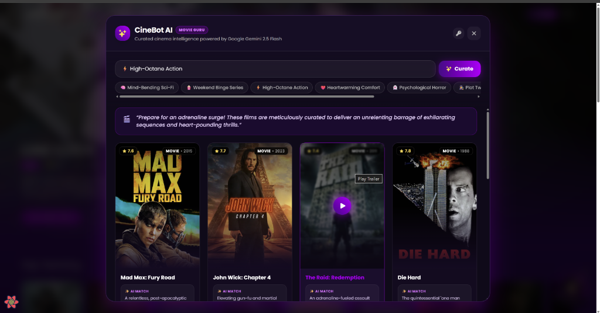
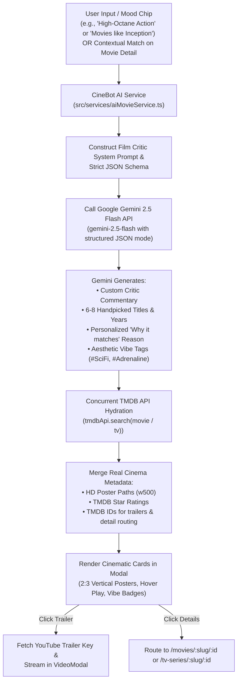

# MovieBuddy 🎬

> A responsive cinematic discovery web application powered by the TMDB API and Google Gemini 2.5 Flash.

[](https://movie-buddy-blue.vercel.app/)
[](https://react.dev/)
[](https://tailwindcss.com/)
[](https://deepmind.google/technologies/gemini/)

---

## 📸 Screenshots

### Home & Trending Showcase


---

### Movies & Category Exploration


---

### Movie Details, Backdrop & Overview


---

### Cast & Character Filmographies


---

### Video Trailers & Teasers


---

### TV Series & Episode Catalog


---

### Actor Details & Full Credits


---

### Search & Instant Filtering


---

### CineBot AI — Personalized Cinema Curator & Mood Watchlists
Intelligent movie recommendation engine powered by Google Gemini 2.5 Flash with structured JSON output, real-time TMDB poster hydration, critic commentary, and high-definition card presentation.


---

## 🧠 Flow of AI (Google Gemini 2.5 Flash)

MovieBuddy features **CineBot AI**, a conversational cinema curator designed to eliminate decision fatigue by understanding nuanced vibes, plot premises, and contextual film similarities.



### Key AI Architectural Capabilities:
1. **Gemini 2.5 Flash Structured Mode**: Queries return strictly-typed JSON containing critic analysis, movie titles, release years, recommendation rationale, and vibe hashtags without messy markdown markers.
2. **Real-Time TMDB Hydration**: Titles generated by Gemini are dynamically resolved against TMDB's live database to fetch authentic posters, ratings, and video keys.
3. **Floating 3D Popcorn Cinema Mascot**: An interactive assistant floating at the bottom-right corner featuring quick-curation mood chips, dialog bubbles, and instant watchlist generation.
4. **Resilient Offline Fallback Layer**: If the Gemini API key is missing or rate-limited, CineBot gracefully serves pre-curated cinematic collections across all major moods so users never experience a broken state.

---

## ✨ Features

- 🤖 **CineBot AI Assistant**: Natural language mood-to-movie curation powered by Google Gemini 2.5 Flash.
- 🍿 **Interactive Cinema Mascot**: Floating companion with quick vibe triggers and cinema glasses.
- 🌟 **Trending & Popular**: Real-time trending movies, top-rated TV series, and seasonal releases.
- 🔍 **Instant Search & Genre Filtering**: Search for any film or franchise with instant debounced queries.
- 🎭 **Cast & Crew Filmographies**: Detailed actor filmography pages, character bios, and credited roles.
- 🎬 **Trailers & Video Players**: High-definition YouTube trailer modal overlays right within the interface.
- 📱 **Mobile & Desktop Responsive**: Fully adaptive UI crafted with Tailwind CSS and modern glassmorphism accents.

---

## 🛠️ Tech Stack

- **Frontend**: React 18, TypeScript, Vite
- **Styling**: Tailwind CSS, PostCSS
- **AI Engine**: Google Gemini 2.5 Flash API (`@google/generative-ai` REST endpoint)
- **Cinema Data**: The Movie Database (TMDB) REST API
- **Deployment**: Vercel (Node.js 24.x runtime)

---

## 🚀 Getting Started

### 1. Clone the repository
```bash
git clone https://github.com/Abhip32/MovieBuddy.git
cd MovieBuddy
```

### 2. Install dependencies
```bash
npm install
```

### 3. Setup environment variables
Create a `.env` file in the root directory:
```env
VITE_API_KEY=your_tmdb_api_key_here
VITE_GEMINI_API_KEY=your_gemini_api_key_here
```

### 4. Run the development server
```bash
npm run dev
```

---

## 📄 License
This project is open source and available under the [MIT License](LICENSE).
